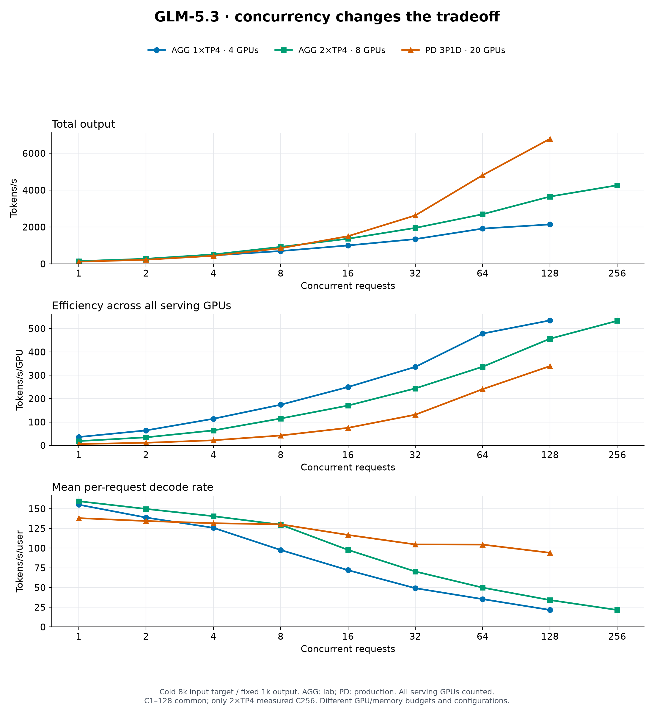
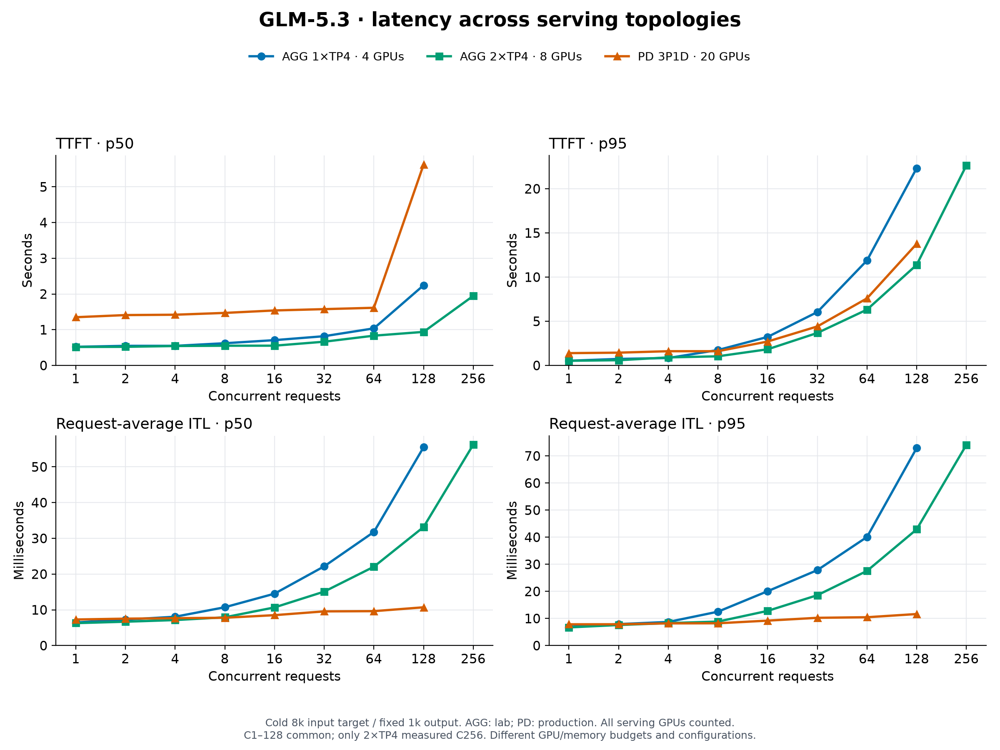
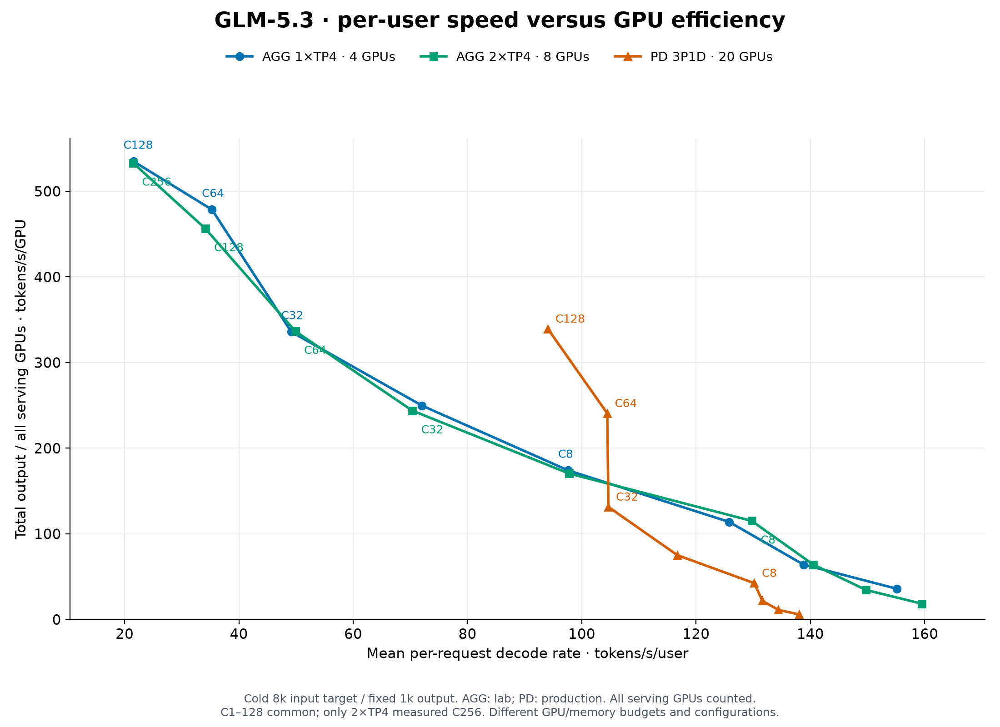
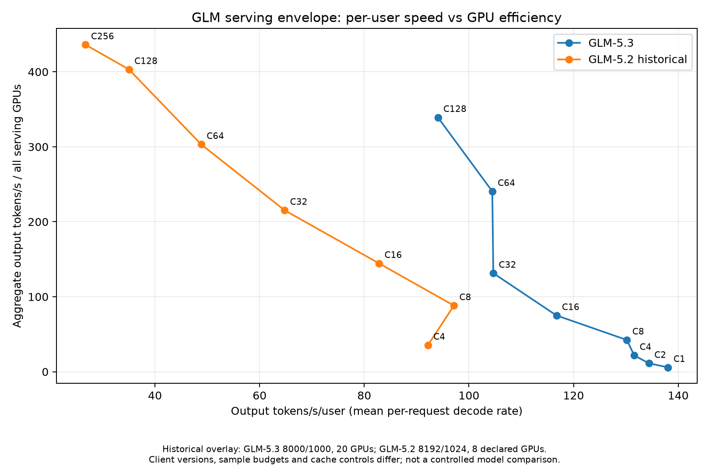

*Updated 2 November 2026 with the completed two-replica experiment.*

Eight B200 GPUs: one TP8 instance or two TP4 replicas? And when should prefill and decode use separate workers?

Those choices change context capacity, request concurrency, per-user speed and GPU efficiency. I’ve been testing them with GLM-5.3, NVIDIA Dynamo and SGLang. The results show why a peak tokens-per-second number is not enough to choose a deployment.

## What I actually tested

| Deployment | Layout | Serving GPUs | Cold 8k/1k sweep |
| --- | --- | --- | --- |
| AGG 1×TP4 | One engine handling prefill and decode | 4 B200s, lab | C1–128 |
| AGG 2×TP4 | Two independent engines behind the same frontend | 8 B200s, same lab node | C1–256 |
| PD 3P1D | Three TP4 prefill workers feeding one TP8 decoder | 20 B200s, production | C1–128 |

The single TP8 aggregated layout is still a future experiment. Its potential advantages are not measured results in this post.

All three used Dynamo 1.6.0, SGLang 0.5.21, the same pinned GLM-5.3 NVFP4 checkpoint and FP8 KV cache. The checkpoint was `RadixArk/GLM-5.3-NVFP4`, revision `6e389189d564d9d3e4ea7fa284fe91f136d8ae2a`. Their memory budgets, scheduler limits and some kernel/backend settings differed. PD also ran on another cluster. This is a comparison of tested deployments, not an experiment that isolates topology as the only variable.

## TP, DP and DPA: three different things

**Tensor parallelism (TP)** distributes model computation across a GPU group. **Ordinary data parallelism (DP)** serves independent requests using separate complete model replicas.

**Data-parallel attention (DPA)** applies data parallelism to attention: each attention group handles its assigned batches and maintains its own KV state. Other layers retain their configured model parallelism. MoE expert parallelism (EP) is a separate choice; enabling DPA does not automatically enable EP. These distinctions follow the [SGLang 0.5.21 DP/DPA guide](https://github.com/sgl-project/sglang/blob/v0.5.21/docs/docs/advanced_features/dp_dpa_smg_guide.mdx).

Each lab engine used this configuration fragment:

```yaml
tensor-parallel-size: 4
data-parallel-size: 4
enable-dp-attention: true
```

That is **one TP4 engine with four attention groups**, not four complete model copies. The two-replica deployment has **two such engines**. It combines ordinary replication between engines with DPA inside each engine. The outer request router here was **Dynamo**, not SGLang Model Gateway.

The PD prefill workers used TP4/DPA4 and explicitly configured EP4; the decoder used TP8/DPA8. The AGG configuration did not enable that same prefill EP/backend combination. This is another reason not to credit every performance difference to topology alone.

## First, make long context work

My initial target was inputs above 500k tokens while keeping PD prefill at TP4. The recipe-based starting configuration produced a KV pool of only about **328k tokens per rank** in my environment.

A context setting does not allocate the memory needed to serve it. I bounded prefill batches and chunks, disabled decode CUDA graphs on prefill-only workers, adjusted the static memory budget and set prefill maximum running requests (MRR) to four: **one per DPA rank**.

The working prefill settings included `mem-fraction-static: 0.93`, `max-prefill-tokens: 8192` and `chunked-prefill-size: 4096`. The live prefill pool grew above **565k tokens per rank**. These are role- and workload-specific settings, not a universal recipe: a higher static fraction leaves less execution headroom, including for lazily loaded kernels.

I validated a **510,012-token input** and a selected **4,000-request WEKA replay with zero errors**, including inputs above 500k. The total input-plus-output cap was 524,288 tokens. The replay was a bounded subset, not the entire source corpus.

The same PD deployment completed Terminal-Bench with **72/89 tasks solved (80.9%)**. That score belongs to the model, agent harness and serving configuration together. Five agent timeouts remained scored failures. It does not prove that topology tuning improved model accuracy, and it is not an AGG quality score.

## Context capacity also needs a correctness check

[Cloudflare’s GLM-5.3 incident report](https://blog.cloudflare.com/kv-cache-exposure-remediation/) shows why this matters beyond capacity. A prefill pool smaller than the advertised context exposed an SGLang rejection-path bug: decode consumed stale KV pages and returned another request’s data. Successful HTTP responses did not establish correctness.

Our PD pools exceeded the configured cap, but that alone does not prove isolation. The measurements above used SGLang 0.5.21; Cloudflare recommends 0.5.22 or later for the incident fix and related hardening. A runtime review must check the exact image and patches, including transfer failure and deferred-release handling. Dynamo’s cancellation path needs its own verification; an SGLang router fix does not automatically cover it.

My follow-up checks are boundary rejection, cancellation during transfer, and controlled cross-request markers alongside output validation. Those tests remain separate from the successful replay and throughput results reported here.

## Use a cold baseline to compare performance

The WEKA replay had substantial prefix-cache reuse and limited session concurrency. I used a separate cold test to measure the serving curve:

- **8,000-token input target, fixed 1,000 output tokens**, with streaming responses. Server-counted input averaged about 8,012 tokens after templating.
- Concurrency 1, 2, 4, 8, 16, 32, 64 and 128 for every deployment; an additional C256 for 2×TP4.
- `max(32, 4 × concurrency)` measured requests and 16 warmups per point.
- Different seeds and cache salts between points; server-reported token counts.

The 1×TP4 and PD sweeps each completed **1,088 measured requests**. The 2×TP4 sweep completed **2,112**. Every point passed with zero errors and no reported prompt-cache reuse. Both AGG campaigns also captured engine cache counters; the older PD summaries retained client cache evidence. No serving pod replacements or new restarts were observed across the runs.

For 2×TP4, I verified eight distinct GPUs: four on NUMA0 and four on NUMA1. Both workers handled requests at every point; their prompt-token shares were approximately 50/50 at C64, C128 and C256. Those counter windows include warmups.

## Compare at the same total concurrency first

At **C128**, the measured results were:

| Measurement | AGG 1×TP4 | AGG 2×TP4 | PD 3P1D |
| --- | --- | --- | --- |
| Serving GPUs | 4 | 8 | 20 |
| Output tokens/s | 2,139 | 3,652 | 6,785 |
| Output tokens/s/GPU | 535 | 456 | 339 |
| Mean decode tokens/s/user | 21.57 | 34.11 | 94.07 |
| TTFT p50, seconds | 2.244 | 0.939 | 5.619 |
| TTFT p95, seconds | 22.335 | 11.389 | 13.770 |
| Request-average ITL p50, ms | 55.49 | 33.17 | 10.71 |
| Request-average ITL p95, ms | 72.92 | 42.90 | 11.64 |

All serving GPUs count in the denominator, including PD’s twelve prefill GPUs. **TTFT** is time to first token. **ITL percentiles here describe per-request average decode intervals**, not the distribution of every individual token gap. The per-user decode rate excludes the first-token wait; dividing aggregate throughput by concurrency need not reproduce it.

[](./glm53-topology-scaling.png)

*Same workload shape; different GPU budgets. Lines stop at their last measured concurrency. [Scalable figure](/plots/glm53-topology-scaling.svg).*

Adding the second TP4 replica increased C128 throughput by **71%**, reduced TTFT p95 by **49%** and reduced ITL p95 by **41%**. Output per GPU fell **15%** at that fixed total concurrency: the demand was now spread across twice the GPUs. The extra capacity improved latency without being fully reflected in per-GPU throughput.

PD still delivered **1.86× the aggregate output** of 2×TP4 and much faster decoding: **94 versus 34 tokens/s/user**. But it used twenty GPUs instead of eight, and its TTFT was not better at this operating point.

## Median TTFT and tail TTFT tell different stories

With one TP4 replica, median TTFT was lower than PD at every tested concurrency, but p95 became higher from C8 onward. Adding the second replica changed that comparison: at C128, **2×TP4 had lower TTFT at both p50 and p95 than PD**, while PD retained much lower decode intervals.

[](./glm53-topology-latency.png)

*TTFT uses seconds; ITL uses milliseconds. Read each percentile separately. [Scalable figure](/plots/glm53-topology-latency.svg).*

So “PD has better latency” is too broad. The answer depends on which latency, percentile and concurrency matters. PD’s generation stage was faster here; 2×TP4 reached the first token sooner at C128. The stage-specific scheduling and memory settings are part of that result, not just the deployment labels.

Low-concurrency points have only 32 measured requests. Their tails are a snapshot, not a contractual guarantee.

## Then compare approximately equal load per replica

C128 across two replicas is not the same demand per engine as C128 on one. A second useful comparison is **1×TP4 at C128 versus 2×TP4 at C256**, where approximate per-replica concurrency matches.

| Measurement | 1×TP4 at C128 | 2×TP4 at C256 |
| --- | --- | --- |
| Output tokens/s | 2,139 | 4,264 |
| Output tokens/s/GPU | 535 | 533 |
| Mean decode tokens/s/user | 21.57 | 21.50 |
| TTFT p95 | 22.335 s | 22.648 s |
| Request-average ITL p95 | 72.92 ms | 74.07 ms |

That is **1.99× aggregate throughput**, nearly unchanged efficiency and similar tail latency. The second replica scaled capacity well when demand increased with it. The total concurrency, sample count and final-point seed differ; this is not a same-concurrency comparison.

There is still a cost to pushing demand. Within 2×TP4, going from C128 to C256 added only **17% throughput**, while TTFT p95 nearly doubled and ITL p95 rose **73%**. C256 reaches configured total MRR, not a latency-qualified operating limit. No latency SLA has been agreed.

## Read the serving envelope

[](./glm53-topology-envelope.png)

*The two AGG curves nearly overlap at comparable per-replica load, but their concurrency labels differ. PD occupies a different part of the speed/efficiency envelope. [Scalable figure](/plots/glm53-topology-envelope.svg).*

The envelope makes the distinction visible: extra replicas can extend total service capacity without improving the per-GPU curve. At another operating point, more concurrency can raise GPU efficiency while reducing each user’s speed.

For a workload that needs fast interactive decoding, PD’s measured decode rate matters. For one prioritising throughput per GPU, the AGG points matter. Neither consideration removes the need to meet first-token and context requirements.

## More replicas do not extend one request’s context

Both AGG configurations retained about **396k GPU KV tokens per rank**, despite a configured 524,288-token context cap. The second replica added independent capacity; it did not combine two rank-local pools for a longer request. Greater-than-500k inputs remain validated for PD only.

MRR is also a scheduler limit, not guaranteed usable capacity:

- AGG 1×TP4: MRR 128 per engine, or 32 per DPA rank.
- AGG 2×TP4: two such engines, giving 256 configured slots in total.
- PD: three prefills with MRR 4 each and a decoder with MRR 256. Those stage limits are not added together to define end-to-end concurrency.

KV capacity can bind before the configured request limit as prompts grow. A successful 8k/1k sweep is not evidence that the same concurrency can run near the context cap.

## Why this differs from scaling a typical web service

A new LLM replica loads another complete **logical model**, with its own scheduling and KV state. Some tensors are sharded; others are replicated according to the parallelism settings. Two TP4 engines do not mean exactly twice every allocation, but they do require two logical model instances.

The eight GPUs share an NVLink/NVSwitch fabric. That connectivity does not automatically deduplicate two engines’ weight allocations. Host NUMA placement is a separate consideration; assigning four GPUs to each NUMA group does not create two disconnected NVLink islands.

Host RAM is separate from GPU HBM too. The first lab worker had a 1 TiB host limit and 75 decimal GB of HiCache per rank. For two replicas, I used 800 GiB and 37 GB per rank: **296 GB total main host cache versus 300 GB** before. This helped fit two workers and the client on the node. The cold-cache checks matter when interpreting that host-cache difference.

These measured deployments therefore differ in more than replica count. PD also uses different stage-specific memory, MRR and backend settings. Per-GPU normalization describes an efficiency metric; it does not make those configurations experimentally identical.

## Placement is only the beginning of the PD path

[llm-d’s GKE study](https://llm-d.ai/blog/topology-as-an-end-to-end-contract) connects device allocation, transport verification and router pairing. A matched GPU/NIC allocation does not prove which path a live KV transfer uses. Their UCX/NIXL stack can silently fall back to TCP.

Our checks established GPU/NIC PCIe pairing, NUMA alignment and active InfiniBand links. They did not establish request-level transfer behaviour. Next: correlate requests with per-NIC traffic and transfer timing.

<details>
<summary>Follow-up experiments for this Dynamo PD deployment</summary>

1. Pin Mooncake/verbs versions and map prefill-to-decode paths by device identity.
2. Measure transfer bytes, duration and fabric errors under load; check for unintended paths.
3. Check pinned Dynamo support before evaluating locality-aware pairing. Our single decoder leaves only prefill selection to balance locality, cache reuse and load.

The study uses GKE RoCE and NIXL/UCX; ours uses InfiniBand and Mooncake. Its environment variables and gains are not portable defaults. Test one change at a time against the saved baseline.

</details>

## What remains to test

Next is **one aggregated TP8 instance on the same eight-GPU node**, with a comparable total host-cache budget. I will measure both its serving curve and actual per-rank context capacity before claiming either advantage.

Wider expert parallelism with DPA is another coordinated design, not simply two independent replicas sharing weights. It needs validation for the model, quantization, kernels and pinned runtime. AGG quality evaluation is also separate from the performance results above.

The practical lesson is to compare context, concurrency, first-token delay, decode speed and the entire GPU budget together. A topology earns its place by meeting the workload’s requirements, not by winning one peak-throughput number.

<details>
<summary>Earlier historical GLM-5.2 comparison</summary>

[](./glm53-pd-vs-glm52-envelope.png)

This older plot compares different models and deployments: GLM-5.3 PD used twenty GPUs and 8,000/1,000 input/output tokens; GLM-5.2 used eight declared GPUs and 8,192/1,024. Client versions, cache controls and sample budgets differed. It is a historical overlay, not the three-configuration experiment above or a controlled model comparison.

</details>

## Data and references

[Download the 25 measured points as CSV](/data/glm53-topology-8k1k-20261102.csv). The data retains exact metrics, request counts, cache evidence and run IDs for PD (27 October), AGG 1×TP4 (1 November) and AGG 2×TP4 (2 November). It includes p99 as well as the p50/p95 shown here; PD has no C256 measurement.

The figures are reproducible from that saved CSV with the website’s `scripts/plot-llm-topologies.py`; generating them sends no inference requests.

- [SGLang 0.5.21 DP, DPA and routing guide](https://github.com/sgl-project/sglang/blob/v0.5.21/docs/docs/advanced_features/dp_dpa_smg_guide.mdx).
- [SGLang 0.5.21 KV pool configurator](https://github.com/sgl-project/sglang/blob/v0.5.21/python/sglang/srt/model_executor/pool_configurator.py).
- [NVIDIA Dynamo GLM-5.3 recipes](https://github.com/ai-dynamo/dynamo/tree/main/recipes/glm-5.3/sglang) — upstream changes; compare a specific revision before borrowing flags.
- [NVIDIA’s DGX B200 fabric description](https://docs.nvidia.com/datacenter/tesla/fabric-manager-user-guide/index.html) and [CUDA memory model](https://docs.nvidia.com/cuda/cuda-programming-guide/02-basics/understanding-memory.html).
